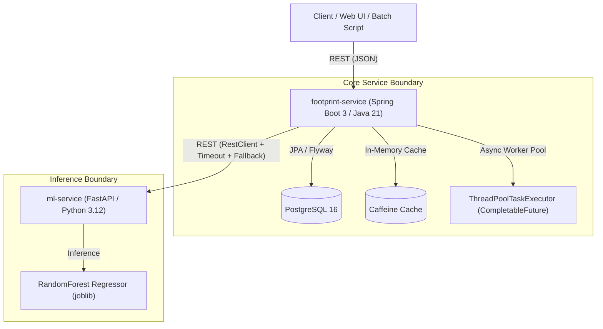

# Carbonstitch Architecture & System Design

## 1. Executive Summary
**Carbonstitch** is an enterprise-grade microservices platform engineered to quantify Scope 1, 2, and 3 carbon footprints (in kg $\text{CO}_2\text{e}$) across global apparel supply chains. Fashion brands and product developers can identify high-emission garments ("hotspots") by disaggregating emissions across raw material extraction, cut-and-sew manufacturing, and multi-modal freight transport.

---

## 2. Microservice Topology

---

## 3. Component Deep Dive

### 3.1 `footprint-service` (Java 21, Spring Boot 3.3.5)
- **Primary Function**: Core transactional and calculation engine.
- **Data Store**: PostgreSQL 16 with automated Flyway schema evolution (`V1__init_schema.sql`, `V2__seed_emission_factors.sql`).
- **Calculation Engine**:
  - **Rule-Based LCA**: Computes cradle-to-gate emissions across three tiers:
    $$\text{Total CO}_2\text{e} = E_{\text{materials}} + E_{\text{manufacturing}} + E_{\text{logistics}}$$
    - $E_{\text{materials}} = \sum (\text{weight} \times \text{share}_i \times \text{Factor}_{\text{material}_i})$
    - $E_{\text{manufacturing}} = \text{weight} \times \text{GridFactor}_{\text{country}}$
    - $E_{\text{logistics}} = \frac{\text{weight}}{1000} \times \text{distance} \times \text{TransportFactor}_{\text{mode}}$
  - **Dynamic Driver Identification**: Identifies which specific material drove the highest portion of the overall footprint.
  - **Resilient ML Integration**: When garment material compositions are unspecified, the service calls `ml-service` via Spring `RestClient`. It incorporates retry policies and graceful degradation to a deterministic category-level proxy if `ml-service` is offline.
  - **Asynchronous Batch Execution**: Bulk calculation (`POST /api/v1/footprints/batch`) is handled off the request thread via `@Async` and `CompletableFuture`, returning a `202 Accepted` response with an immutable `jobId` for progress polling.
  - **In-Memory Caching**: Caffeine near-cache memoizes emission factor lookups to eliminate redundant DB reads in calculation loops.

### 3.2 `ml-service` (Python 3.12, FastAPI)
- **Primary Function**: Predictive emission inference when upstream bill-of-materials (BOM) data is missing or incomplete.
- **Model Pipeline**:
  - Scikit-learn Pipeline using `OneHotEncoder` and `StandardScaler`.
  - Trained on 5,000 synthetic LCA proxy records generated with fixed seed `42`.
  - Model selection: Compares `LinearRegression` vs `RandomForestRegressor` on held-out test split.
  - Real evaluated test metric: **MAE 0.9799 kg $\text{CO}_2\text{e}$** (RandomForest) vs 1.8462 kg $\text{CO}_2\text{e}$ (Linear Regression).
- **Runtime Performance**: Lightweight serialized model (`286 KB`), loaded in memory once at startup; sub-millisecond inference time per item.

### 3.3 PostgreSQL 16
- Stores catalog entities (`garments`), material percentages (`material_compositions`), computed emissions (`footprint_results`), emission factor tables (`emission_factors`), and background batch tracking (`calculation_jobs`).
- Indexed on `sku`, `garment_id`, and `total_kg_co2e DESC` for efficient analytical hotspot filtering.

---

## 4. Key Architectural Decisions

| Decision | Alternative Considered | Rationale |
|---|---|---|
| **Asynchronous Batch Execution** | Synchronous iteration | In real retail environments, catalog imports encompass thousands of SKUs. Synchronous calculation blocks HTTP connections and causes gateway timeouts. A `202 Accepted` pattern with background job worker decouples client request latency from computation scale. |
| **Caffeine Near-Cache** | Direct DB queries or Redis | Emission factors change infrequently (annually or per LCA update cycle). An in-process Caffeine cache delivers sub-microsecond factor resolution without adding distributed caching network hops. |
| **Circuit Breaker / Graceful Fallback** | Hard failure / 500 error | Upstream ML services may experience downtime or network partitions. In a production catalog ingestion pipeline, falling back to rule-based category benchmarks maintains service availability. |
| **Flyway Schema Evolution** | JPA `ddl-auto: update` | Enterprise production requires immutable, reviewable, and version-controlled SQL migration scripts rather than dynamic schema generation. |
